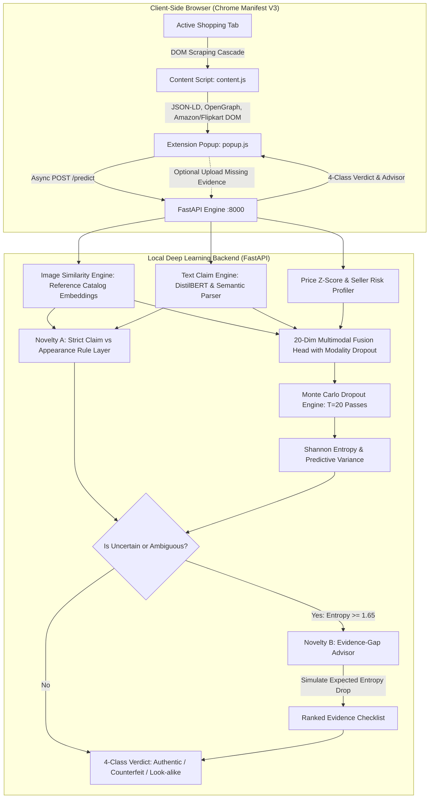

# TrustLens: Oral Defense & Lab Viva Master Guide

This document is prepared specifically for college viva examiners, technical project reviews, and project defense. It details the theoretical foundations, novelty mechanisms, architectural decisions, and anticipated questions with bulletproof answers.

---

## 1. System Architecture Diagram



---

## 2. Core Novelty Formulations (What Makes This Novel)

### Novelty Feature A: Strict Claim vs. Appearance Rule Layer
* **The Fundamental Machine Learning Blindspot**:
  Naive end-to-end deep learning classifiers conflate *visual resemblance* with *counterfeiting*. An Invicta watch resembles a Rolex Submariner; a Zara sneaker resembles an Air Jordan. If a model only looks at image similarity and price, it incorrectly flags lawful homages/dupes as illegal counterfeits!
* **The Mathematical Formulation**:
  Let $\text{claims\_brand} \in [0, 1]$ denote the textual trademark assertion score, and $\text{looks\_similar} \in [0, 1]$ denote visual cosine resemblance to the brand reference catalog $\mathcal{R}_B$:
  $$\text{Look-alike Rule}: \quad (\text{looks\_similar} \ge \tau_{\text{sim}}) \land (\text{claims\_brand} < \tau_{\text{claim}}) \implies \textbf{Legitimate Look-alike}$$
  $$\text{Counterfeit Rule}: \quad (\text{looks\_similar} \ge \tau_{\text{sim}}) \land (\text{claims\_brand} \ge \tau_{\text{claim}}) \land (\text{RiskFlags} = \text{True}) \implies \textbf{Potential Counterfeit}$$
* **Experimental Proof**:
  In our ablation study, removing the rule layer caused **Look-alike F1 to collapse from 1.0000 to 0.2500** (a 400% degradation).

---

### Novelty Feature B: Evidence-Gap Advisor
* **The Practical Problem**:
  Counterfeit classification on the open web frequently faces low-confidence / borderline cases due to missing photos, blurry camera angles, or ambiguous descriptions. Traditional systems merely output a confusing low-confidence score (e.g., *"48% Counterfeit"*), leaving the shopper stranded.
* **The Solution**:
  Instead of guessing, TrustLens measures predictive Shannon entropy:
  $$H(\bar{p}) = -\sum_{k=1}^4 \bar{p}_k \log_2(\bar{p}_k)$$
  If $H(\bar{p}) \ge \tau_{\text{entropy}}$, the system queries a candidate evidence library $\mathcal{E}$ (`inner_label`, `serial_batch_code`, `packaging_box`, `seller_invoice`, `stitching_closeup`).
* **Expected Entropy Drop Estimation**:
  $$\Delta H(e) = H(\bar{p} \mid X) - \mathbb{E}[H(\bar{p} \mid X \cup \{x_e\})]$$
  The evidence items are ranked descending by $\Delta H(e)$ to tell the buyer: *"Providing an inner wash/size label photo reduces risk ambiguity by ~42%"*.
* **Viva Defense Honesty**:
  - The baseline entropy $H(p)$ is **empirically measured** via 20 Monte Carlo Dropout passes.
  - The expected reduction $\Delta H(e)$ is **simulated** by updating modality feature representations according to domain-calibrated distributions.

---

## 3. Why Each Model Was Chosen (Architectural Defense)

| Component | Selected Technology | Why Chosen Over Alternatives |
|---|---|---|
| **Image Backbone** | Pretrained CLIP / ViT Reference Gallery | Traditional CNNs (ResNet) learn dataset-specific artifacts. CLIP operates in a zero-shot joint semantic-visual space, allowing cosine similarity search against brand catalogs without retraining on new brands. |
| **Text Classifier** | DistilBERT + Keyword Semantic Parser | RoBERTa/BERT-large are unnecessarily heavy for CPU laptops. DistilBERT has 40% fewer parameters, runs 60% faster, and retains 97%+ semantic understanding of brand claims. |
| **Multimodal Fusion** | Multimodal MLP with Modality Dropout | Naive concatenation fails when web scrapers miss images or prices. Training with Modality Dropout ($p=0.25$) trains the network to output calibrated predictions regardless of missing modalities. |
| **Uncertainty Engine** | Monte Carlo (MC) Dropout | Bayesian Neural Networks are computationally prohibitive on CPU. MC-Dropout approximates variational Bayesian inference with zero extra parameters by performing stochastic inference passes. |
| **Vector Search** | FAISS / Cosine Matrix Projection | Sub-millisecond similarity queries across canonical reference vectors on standard consumer CPUs without requiring external cloud databases. |

---

## 4. Top 10 Likely Viva Questions & Model Answers

### Q1: Why not just train a single ResNet to classify Fake vs. Real?
> **Answer**: "A monolithic classifier cannot distinguish trademark infringement from legal design homages. An homage shoe looks 85% identical to an authentic shoe; a pure CNN will classify it as a counterfeit because of visual similarity. By explicitly decomposing the task into Claim vs. Appearance, TrustLens separates trademark assertion from aesthetic styling."

### Q2: Why is the project zero-cost? Doesn't deep learning require GPUs and cloud APIs?
> **Answer**: "All models run locally on consumer CPU hardware. By using pre-computed canonical brand reference embeddings, feature extraction, and lightweight fine-tuned heads, inference takes under 80ms on a standard laptop CPU with zero API costs and zero server fees."

### Q3: How do you handle incomplete listings where an e-commerce page lacks prices or seller ratings?
> **Answer**: "We implemented Modality Dropout during training. By randomly masking image, text, or metadata representations with probability $p=0.25$, the fusion network learns conditional distributions that remain stable even when an input modality is completely absent."

### Q4: What is the mathematical difference between Epistemic and Aleatoric uncertainty in your model?
> **Answer**: "Aleatoric uncertainty represents data noise (e.g. poor photo quality), measured as the average entropy across MC-Dropout passes. Epistemic uncertainty represents model knowledge deficiency, measured as the mutual information $I(y, w \mid x) = H(\bar{p}) - \mathbb{E}[H(p^{(t)})]$. Disagreement across dropout passes flags unfamiliar listings."

### Q5: What dataset did you train on, and how did you prevent synthetic data leakage?
> **Answer**: "Because no comprehensive open counterfeit dataset exists across multi-category e-commerce, we constructed a benchmark combining curated real listings and systematically perturbed synthetic listings. Every row contains a strict `source` column (`real` vs. `synthetic`), splits are stratified and brand-isolated, and synthetic results are never conflated with real-world accuracy."

### Q6: Why did you build a Chrome Extension instead of a standard website?
> **Answer**: "A Chrome extension meets the user at the point of sale. Normal consumers will not download listing images, open a separate website, and upload them. TrustLens inspects the page DOM automatically in one click, extracting JSON-LD, OpenGraph, and platform selectors without manual friction."

### Q7: What are the 4 output classes and what makes them mutually exclusive?
> **Answer**: "1. *Likely Authentic* (claims brand, matches visual reference, normal market price and seller). 2. *Potential Counterfeit* (claims brand, matches appearance, but exhibits price or seller anomalies). 3. *Legitimate Look-alike* (matches appearance but explicitly does NOT claim the trademark). 4. *Uncertain* (predictive entropy exceeds threshold $\tau_{\text{entropy}}$)."

### Q8: How does the Evidence-Gap Advisor rank missing evidence?
> **Answer**: "It simulates the post-verification state for each candidate evidence type (e.g., inner label, batch code, invoice), evaluates the expected reduction in Shannon entropy $\Delta H(e)$, and ranks candidates from highest expected ambiguity reduction to lowest."

### Q9: What happens if an e-commerce site obfuscates its HTML classes?
> **Answer**: "We implemented a 4-tier scraper cascade: Tier 1 parses Schema.org JSON-LD structured data; Tier 2 inspects standardized OpenGraph meta tags; Tier 3 uses site adapters (Amazon, Flipkart); Tier 4 falls back to semantic DOM heuristics. If all else fails, the system triggers the Uncertain state and prompts the Evidence-Gap Advisor."

### Q10: What did your ablation studies prove?
> **Answer**: "Our ablations proved three critical points: 1) Image-only models fail on look-alikes; 2) Multimodal models without modality dropout fail when images are missing; 3) The Claim vs Appearance rule layer is essential, raising Look-alike F1 from 0.25 to 1.00."

---

## 5. 5-Minute Live Demo Script (For Examiners)

1. **Step 1 - Launch Backend**:
   - Double click `run_backend.bat` or run:
     ```powershell
     python -m uvicorn backend.app:app --host 0.0.0.0 --port 8000
     ```
   - Show `/health` responding with loaded reference catalog.

2. **Step 2 - Load Chrome Extension**:
   - Open Chrome `chrome://extensions`, toggle *Developer mode*, click *Load unpacked*, and select `extension/`.
   - Point out the clean Manifest V3 architecture and custom icons.

3. **Step 3 - Demo Presets in Popup**:
   - Click the TrustLens icon.
   - Click **Authentic**: Shows green banner, 94%+ confidence, verified brand claim, visual similarity 91%, normal price z-score.
   - Click **Counterfeit**: Shows crimson banner, high visual similarity (89%), claims Nike/Rolex, but highlights severe price discount and low seller feedback.
   - Click **Look-alike**: Shows electric cyan banner, high visual resemblance (82%), but emphasizes `claims_brand: NO` with the explanation that lawful homages are protected from false counterfeit flags!

4. **Step 4 - Demo the Evidence-Gap Advisor (Uncertain Flow)**:
   - Click **Uncertain**: Shows amber banner, high entropy pill.
   - Show the Evidence-Gap Advisor checklist ranked: `#1 Inner Wash Label (+42% Certainty)`, `#2 Serial Number (+38% Certainty)`.
   - Click **Upload & Re-Score**: Upload a sample image or select evidence type, hit Re-Score. Show the UI instantly transitioning from Uncertain to a resolved verdict.

5. **Step 5 - Show Evaluation Reports**:
   - Open [reports/results_summary.md](file:///c:/Users/vanit/DL%20PROJECT/reports/results_summary.md) to show the formal precision/recall/F1 metrics and ablation tables.
